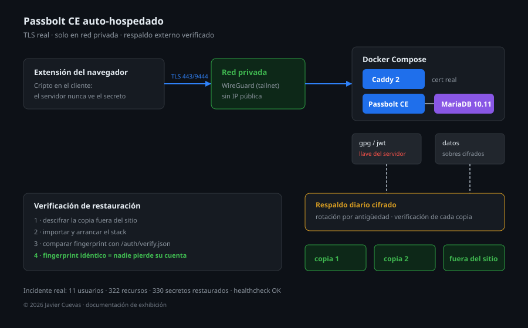

# Passbolt self-hosted: gestor de secretos con recuperación real

Passbolt Community Edition auto-hospedado para un equipo pequeño: TLS propio, red privada en lugar de internet, respaldo externo cifrado y verificado, y un procedimiento de recuperación **probado en un incidente de verdad**, no en un diagrama.



## El problema

Un gestor de contraseñas compartido para el equipo tiene un requisito distinto al de una app cualquiera: si se cae, nadie accede a nada — correos, bancos, paneles, llaves SSH. Y si se levanta de cero sin cuidado, puede arrancar *con la llave equivocada* y dejar a todos fuera de sus propios secretos.

SaaS lo resuelve con dinero y confianza. La alternativa auto-hospedada exige resolver tres cosas que SaaS esconde: la llave del servidor, el respaldo que de verdad restaura y el procedimiento cuando alguien pierde su recovery kit.

## Arquitectura

```
extensión (cripto en el navegador del usuario)
        │  TLS — solo dentro del tailnet, sin exposición a internet
        ▼
   Caddy 2  (certificado real, no autofirmado)
        ▼
   Passbolt CE  ──►  MariaDB 10.11
        │                  │
   vol. gpg/jwt        vol. datos
        └────────┬─────────┘
                 ▼
        respaldo diario cifrado ──► 3 copias, 1 fuera del sitio
```

Cuatro contenedores, una red interna, puertos publicados solo en la interfaz privada. La criptografía de los secretos ocurre **en el cliente**: el servidor guarda sobres cifrados y nunca ve una contraseña en claro.

Decisiones que importan:

- **Red privada en vez de IP pública.** El gestor de secretos no necesita estar en internet; necesita estar en el mismo tailnet que el equipo. Cero superficie de ataque expuesta, cero certificados que renovar a mano.
- **TLS real.** Certificado válido para el nombre del nodo, emitido por la CA del propio tailnet. Un autofirmado obliga a cada usuario a aceptar excepciones y entrena a ignorar advertencias.
- **La llave del servidor es el sistema.** Todo lo demás es reemplazable.

## El incidente que validó el diseño

El servidor de producción se cayó por un apagón y no volvió a arrancar. La última copia externa era de las 04:15 de esa madrugada.

Se levantó una instancia temporal en otro nodo, desde la copia cifrada offsite: descargada, descifrada, importada. Resultado verificado:

| | |
|---|---|
| Usuarios | **11** |
| Recursos | **322** (259 activos) |
| Secretos | **330** |
| Llave del servidor | **idéntica a producción** — sin alarma de "llave cambiada" en la extensión |
| `healthcheck` | `OK` |

Ese último renglón es el que hace la diferencia entre recuperar el servicio y perder a los usuarios: si la llave cambia, cada persona tiene que volver a enrolar su cuenta.

## Las cuatro trampas (y cómo se detectaron)

1. **El primer arranque generó una llave nueva, en silencio.** El paquete de respaldo trae la llave, pero si el directorio montado llega vacío, el entrypoint genera una llave nueva sin avisar. El servidor queda funcionando y *anunciando el fingerprint equivocado*. Detección: comparar `GET /auth/verify.json?api-version=v2` contra el fingerprint conocido, siempre, antes de decir "arriba".
2. **Los bind-mounts deben pertenecer al uid 33** (`www-data`). Si no, `gpg` no puede crear su directorio y el contenedor entra en bucle de reinicio sin decir por qué.
3. **El certificado de tailnet solo se emite para el nombre del propio nodo.** Desde el nodo temporal no se puede pedir el certificado del nombre de producción: error 500, "invalid domain". Solución: publicar en el nombre del nodo que sí puede emitirlo, en un puerto libre.
4. **Un volumen del código de la aplicación no estaba incluido en el respaldo.** Lo correcto fue quitar el montaje y usar el código que ya trae la imagen; las migraciones se aplican solas al arrancar.

## Respaldo que se puede creer

Diario, cifrado, y verificado —no "configurado":

- Empaquetado y cifrado por conjunto, con rotación por antigüedad.
- **Tres copias por elemento**, una fuera del sitio.
- El verificador comprueba la existencia de cada copia y cierra con `RESULTADO: OK`; si falta una, el log lo dice con nombre y hora.
- Restauración probada de punta a punta: es exactamente lo que trajo los 330 secretos de vuelta.

## Recuperación de usuarios

Passbolt tiene un agujero conocido: si un usuario pierde su recovery kit o su passphrase, sus secretos se pierden con él, incluso para el administrador del servidor.

En este despliegue hay un procedimiento para eso. Los kits quedan en custodia cifrada y la recuperación exige la participación de varios responsables: ninguna persona sola, ninguna llave sola. Cambiar la passphrase de un kit conserva el fingerprint original, así que el usuario no tiene que volver a enrolarse.

Ese procedimiento y la herramienta que lo acompaña no están en este repositorio. Es la parte del proyecto que más trabajo tiene detrás y queda fuera de la exhibición.

## Stack

Passbolt CE · MariaDB 10.11 · Caddy 2 · Docker Compose · Tailscale (red y certificados) · rclone (respaldo cifrado externo) · OpenPGP.js

## Sobre el código

Este repositorio es **documentación de exhibición**: arquitectura, decisiones, incidente real y resultados. No incluye código de despliegue, configuración funcional, dominios ni llaves.

© 2026 Javier Cuevas. Todos los derechos reservados. Disponible bajo licencia por contacto.
