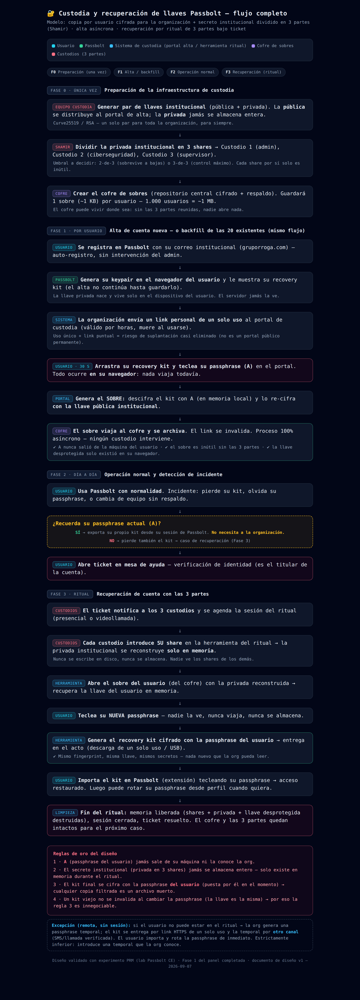

# Custodia de recovery kits y recuperación de cuentas

El problema estructural de Passbolt: la llave privada de cada usuario vive cifrada con su passphrase. Si la pierde, sus secretos son irrecuperables **incluso para el administrador del servidor**. Un equipo que adopta el gestor necesita una respuesta a esa pregunta antes de usarlo.

## Modelo

1. **Cada usuario entrega su kit cifrado** a un cofre institucional. El sobre se cifra con la llave pública institucional en el navegador del propio usuario: la passphrase no sale de su máquina y el servidor de custodia nunca ve nada en claro.
2. **La llave privada institucional se reparte** entre tres custodios con esquema de umbral: hacen falta dos de tres partes para reconstruirla. Ningún custodio, por sí solo, puede abrir el cofre.
3. **La reconstrucción ocurre solo en memoria** durante el ritual, con los custodios presentes (presencial o por videoconferencia). No se escribe en disco y se destruye al terminar.
4. **Se entrega un kit nuevo** con una passphrase nueva, se importa en la extensión y la cuenta vuelve a funcionar.

Reglas del diseño:

- La contraseña del usuario nunca sale de su equipo.
- El secreto institucional nunca se almacena completo en un solo lugar.
- Los sobres son archivos cifrados pasivos: robarlos no sirve sin el umbral de custodios.
- Cambiar la passphrase de un kit **no invalida llaves anteriores** — por eso el paso de verificación es obligatorio.

## Panel de reprotección (herramienta)

Panel web **100 % cliente** para cambiar la passphrase de un recovery kit sin cambiar la llave:

- UI de tres pasos: cargar kit → passphrase actual y nueva → resultado y verificación.
- OpenPGP.js servido **local**: funciona sin internet.
- Sin servidor de aplicación: se sirve como estático en `127.0.0.1`, sin logs, sin persistencia.
- Al terminar: **fingerprint idéntico** al original, la copia nueva abre con la passphrase nueva y **rechaza la anterior**. Si cualquiera de las tres comprobaciones falla, no se entrega el archivo.

| Comprobación | Criterio |
|---|---|
| Fingerprint antes / después | idéntico |
| Desbloqueo con passphrase nueva | correcto |
| Desbloqueo con passphrase anterior | rechazado |

Esa última fila es la que distingue una herramienta funcional de una que produce kits a medias.
